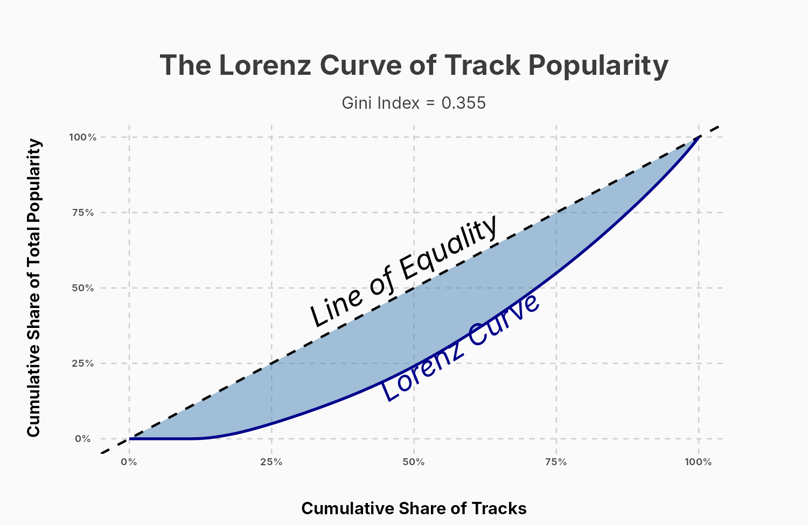
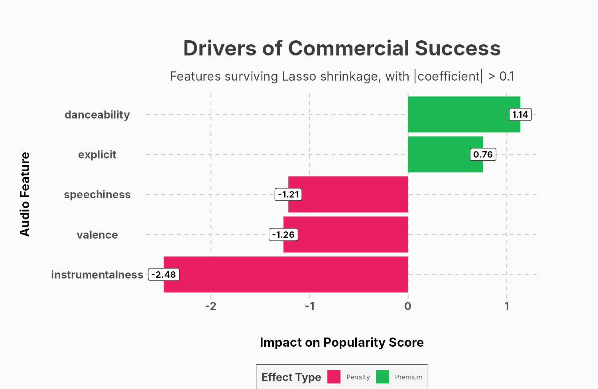
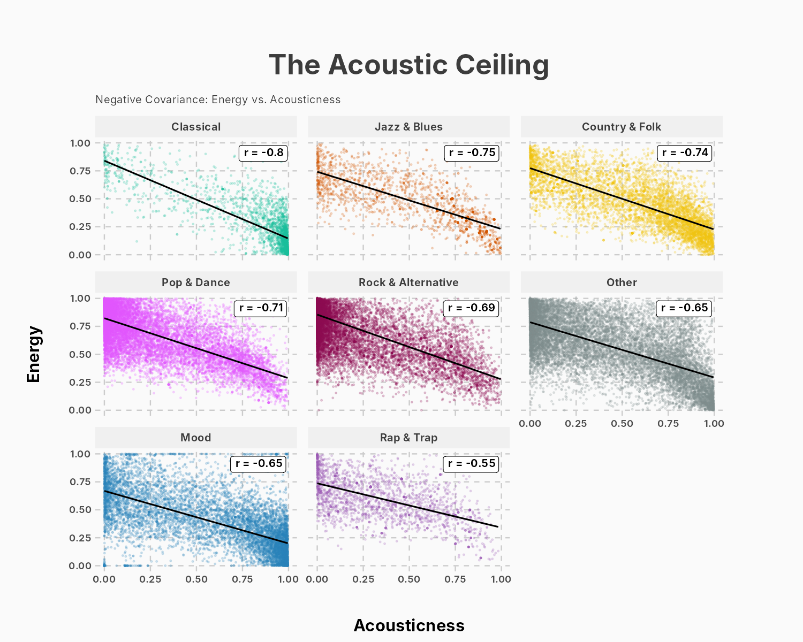
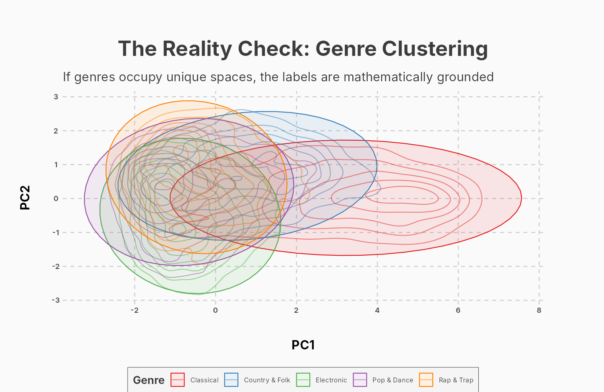

# Spotify - What Drives Track Popularity

A statistical analysis of 114,000 Spotify tracks to understand how popularity is distributed across the catalogue and which audio features, if any, are associated with it. The whole analysis is written in **R**, and the results were presented as a slideshow styled like the Spotify app.

<p align="center">
  
  
</p>

---
## Overview

For the Fundamentals of Statistics course, we played the role of an analytics team working with Spotify's Personalisation & Discovery team, whose goal is to make content discovery easier for casual listeners. The question behind the project is which genres and audio characteristics are most strongly associated with the popularity of a track, so that they can be used in content-based recommendation strategies.

We translated this into four business inquiries, each answered with a different statistical technique:

1. **Is Spotify a winner-takes-all market?** Distribution of popularity, Lorenz curve and Gini index.
2. **Are there standard production rules?** Correlation between audio features and how it changes across genres.
3. **How does an algorithm "hear" music?** Principal Component Analysis, to see whether human genres form distinct groups in the space of audio features.
4. **Can popularity be predicted from audio features?** Multiple linear regression, 10-fold cross-validation and Lasso regression.

---
## Key findings

| Inquiry | Technique | Main result |
| ------- | --------- | ----------- |
| Market concentration | Lorenz curve, Gini index | Gini index of 0.355, with 9,440 tracks at popularity 0 |
| Production rules | Correlation matrix | No audio feature correlates with popularity (all \|r\| ≤ 0.13); energy and loudness r = 0.76, energy and acousticness r = -0.73 |
| Genres in the audio space | PCA | The first two components explain 48% of the variance; Pop & Dance, Rap & Trap and Electronic overlap almost completely |
| Predicting popularity | MLR, 10-fold CV, Lasso | Cross-validated R² of 4.4% (RMSE 20.1 points) |

- **The market is tiered, not monopolised.** The distribution of popularity is right skewed and has a large spike at zero, but a Gini index of 0.355 points to a moderate concentration. Besides the few hits at the top, a large "middle class" of tracks keeps a steady level of popularity.
- **There is no single formula for a hit.** Popularity is almost uncorrelated with every audio feature taken alone. The features are strongly related to each other instead, and these relations change with the genre: energy and loudness go together much more in Classical (r = 0.84) than in Hip-Hop and Rap & Trap (r = 0.63), and the trade-off between energy and acousticness goes from r = -0.80 in Classical to only r = -0.20 in Hip-Hop.
- **Some human genres look the same to an algorithm.** Once the labels are removed, Classical stands apart along the first component (acoustic and instrumental against loud and energetic tracks), while Pop & Dance, Rap & Trap and Electronic occupy the same region of the plane.
- **Audio features explain very little of popularity.** A linear model with all the features reaches an R² of 3.3%, and adding the two interactions found in the correlation analysis brings the cross-validated R² to 4.4%. The Lasso keeps danceability (+1.14) and explicit content (+0.76) as positive drivers and instrumentalness (-2.48), valence (-1.26) and speechiness (-1.21) as negative ones. Most of the variation in popularity depends on factors that are not in the dataset, such as marketing, playlist placement and the artist's audience.

<p align="center">
  
  
</p>

---
## Repository structure

```
stats-spotify-popularity/
├── R/
│   ├── 00_setup.R                     packages, plot theme, data loading and deduplication
│   ├── 01_popularity_concentration.R  question 1: distribution, Lorenz curve, Gini index
│   ├── 02_feature_covariance.R        question 2: correlation matrix and covariance by genre
│   ├── 03_pca_genres.R                question 3: PCA and genre clustering
│   └── 04_popularity_regression.R     question 4: MLR, cross-validation and Lasso
├── data/
│   └── spotify_tracks.csv             Spotify Tracks dataset (114,000 tracks)
├── figures/                           figures created by the scripts
├── reports/
│   └── presentation.pdf               slideshow used for the presentation
├── LICENSE
└── README.md
```

---
## Reproducing the analysis

The scripts only use the file saved in `data/` and must be run from the root of the repository. Each script sources `R/00_setup.R` and saves its figures in `figures/`. The seed is fixed, so the cross-validation and the Lasso give the same results at every run.

```bash
# 1. clone
git clone https://github.com/simonecobuccio/stats-spotify-popularity.git
cd stats-spotify-popularity

# 2. install the packages (R 4.3+ recommended)
Rscript -e 'install.packages(c("tidyverse", "ggthemes", "scales", "skimr", "ineq", "corrplot", "factoextra", "caret", "glmnet", "broom"))'

# 3. run
Rscript R/01_popularity_concentration.R
Rscript R/02_feature_covariance.R
Rscript R/03_pca_genres.R
Rscript R/04_popularity_regression.R
```

The scripts can also be opened in RStudio: set the working directory to the root of the repository and run them one at a time.

---
## Data

The data is the [Spotify Tracks dataset](https://huggingface.co/datasets/maharshipandya/spotify-tracks-dataset) published on Hugging Face. It contains 114,000 tracks and covers 114 genres with exactly 1,000 tracks each, and every track has two groups of variables:

- **Track metadata**: track and album identifiers, artists, popularity (an index from 0 to 100 computed by Spotify), duration, explicit content and genre.
- **Audio features**: danceability, energy, key, loudness, mode, speechiness, acousticness, instrumentalness, liveness, valence and tempo.

The dataset is released under the BSD licence, and the credit goes to its original author.

---
## Methodology

`00_setup.R` groups the 114 genres into 11 macro-genres (Pop & Dance, Rock & Alternative, Electronic, Classical and so on) and removes the duplicates. The same track can appear once for each genre it belongs to, so for every `track_id` we keep the row whose macro-genre has the highest average popularity, which brings the dataset from 114,000 to 89,741 unique tracks. Question 1 studies the distribution of popularity with a histogram, the Lorenz curve and the Gini index, and compares flops (popularity 0) with hits (popularity 75 or more) on their audio features, duration and explicit content. Question 2 computes the Pearson correlation matrix of the audio features and then repeats the two strongest correlations within each macro-genre. Question 3 runs a PCA on the nine standardised audio features and plots five macro-genres on the first two components with density contours and 95% ellipses. Question 4 standardises the features and fits a multiple linear regression on popularity, then a 10-fold cross-validated model that adds the energy-loudness and energy-acousticness interactions, and finally a Lasso regression whose penalty is chosen by cross-validation (`lambda.1se`). Key and mode are left out of the models because they are categorical codes.

---
## Documentation

- [**Slideshow (PDF)**](reports/presentation.pdf): the four business inquiries and their results, as presented in class

---

## Authors

Group project for the Fundamentals of Statistics course of the **Master in Business Analytics and Data Science** at **Politecnico di Milano** GSoM 2025/2026.

- Alexandre Benjamin Cambier
- Simone Cobuccio
- Giancarlo Ferrara
- Davide Tissino

---

## License

The code is released under the [MIT License](LICENSE). The data stays under the licence of the original publisher.
